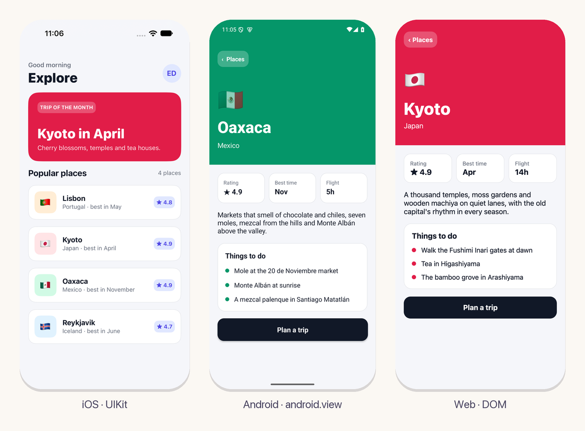
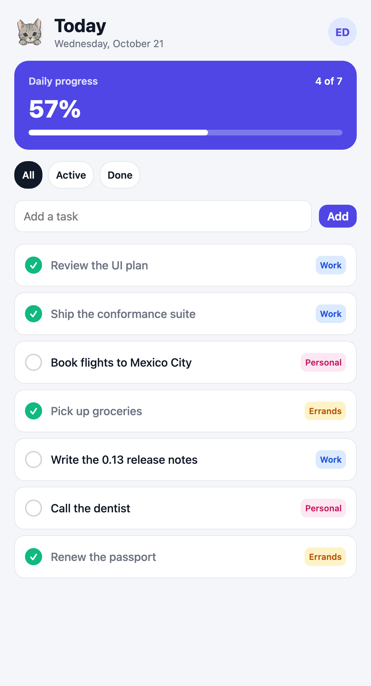
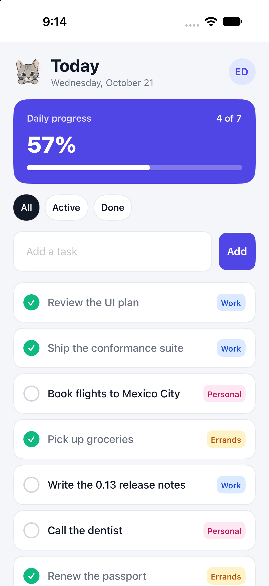
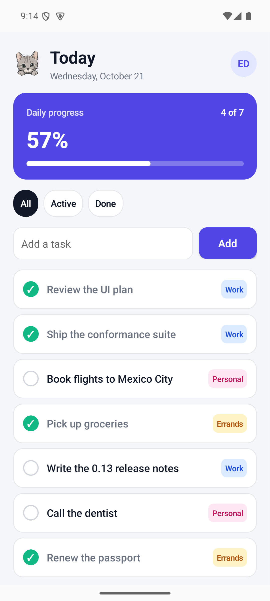
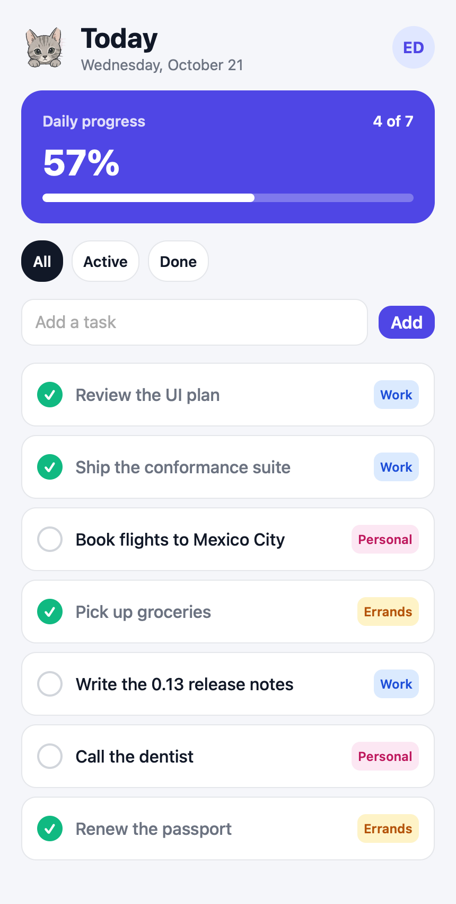

<p align="center">
  
</p>

<h2 align="center">ui</h2>
<p align="center">One UI in Eskiu for iOS, Android, the web and the desktop.</p>
<p align="center"><sub>Part of the <a href="https://github.com/eskiu-lang">Eskiu</a> project</sub></p>
<p align="center">
  <a href="https://eskiu-lang.org">eskiu-lang.org</a> &nbsp;&middot;&nbsp;
  <a href="docs/README.md">Documentation</a> &nbsp;&middot;&nbsp;
  <a href="examples/tasks/src/tasks.esk">Example</a> &nbsp;&middot;&nbsp;
  <a href="https://github.com/eskiu-lang/eskiu">The language</a>
</p>

<p align="center">
  <a href="https://github.com/eskiu-lang/ui/actions/workflows/ci.yml"></a>
  
  <a href="LICENSE"></a>
</p>

---

`ui` is a reactive UI framework in Eskiu. A component is an ordinary function, the view is
built by calls (`Column`, `Row`, `Text`, `Button`), and state lives in signals. The same
code draws UIKit views on iOS and `android.view` views on Android, both laid out by Yoga,
and the DOM on the web through WebAssembly; the desktop runs the web renderer in a webview.

```eskiu
import <string>;
import <ui>;

void Counter() {
    Column(Style{padding: 16}) {
        *Signal<int> count = use_signal<int>(0);
        String label;
        defer String_free(&label);
        String_format(&label, "Count: %d", count.get());
        Text(label.data);
        Button("Increment") { count.set(count.get() + 1); }
    }
}
```

- **Fine-grained updates.** A block records the signals it reads; when one changes, only
  that block runs again and its children are matched against the last render.
- **Native views.** Text, buttons, fields, switches, lists, modals and alerts are the
  platform's own, with their accessibility.
- **Linear updates.** 10,000 rows mount, reverse or unmount in under 10 ms.
- **Checked rules.** Hooks, keys and memos are checked, and a misuse stops with where it
  happened: `in Column[0] > TodoRow[key 3]`.
- **Errors that do not close the app.** A render that throws shows the nearest
  `ErrorBoundary`'s fallback, and nothing of it reaches the screen; a handler or an effect
  that throws is reported and the app goes on.
- **Motion.** Transforms and transitions animated by each platform, drags, swipe to
  delete, and the interactive back swipe on iOS.
- **The system.** Dark mode, accessibility settings, the language, sharing, the clipboard,
  haptics, saved data and the network, each through the platform's own API.
- **Navigation.** A router's stack of routes is screens on the phone, with their slides and
  back gestures, and pages with URLs and history on the web.
- **Native code.** An app or a package ships modules and views per platform in `native/`
  (Objective-C or Swift, Java, Kotlin or C, JavaScript), with Maven and Swift package
  dependencies from `ui.toml`. See [native code](docs/native.md).
- **A kit.** `<ui/kit>` adds cards, badges, buttons, fields, checkboxes, tabs, bars,
  accordions, menus, selects, tooltips, toasts and date and color pickers, in a light and a
  dark theme, built from the same elements.

Views are written with Eskiu's trailing blocks: `Column(Style{padding: 16}) { ... }`
passes the block as the call's last argument, `Column(Style{padding: 16}, void() { ... })`.

## Start an app

```bash
git clone https://github.com/eskiu-lang/ui && eskiuc ui/tools/ui/main.esk -o ~/.eskiu/bin/ui
ui new myapp && cd myapp
ui run web        # or macos, linux, windows, ios, android
ui serve          # builds again and reloads on each change
ui open ios       # in Xcode (or android, in Android Studio)
ui release        # for the App Store and Google Play
```

[Getting started](docs/getting-started.md) has what each platform needs and a project's
layout; [Releasing](docs/releasing.md), what a release needs and makes.

## Documentation

| | |
|---|---|
| [Getting started](docs/getting-started.md) | The tool, a first app, the examples |
| [Architecture](docs/architecture.md) | The layers, a frame, the repository |
| [State](docs/state.md) | Signals, memos, effects, hooks, strings, errors |
| [Components](docs/components.md) | `<ui>` and `<ui/kit>` |
| [Style and layout](docs/style-and-layout.md) | `Style`, colors, flexbox, motion |
| [The platform](docs/platform.md) | Dark mode, accessibility, system actions, the network, back, links, alerts, modals |
| [Navigation](docs/navigation.md) | Screens and pages, back, links, the browser's history |
| [Native code](docs/native.md) | Modules and views per platform, `ui.toml`, Gradle and Swift packages |
| [Protocol](docs/protocol.md), [Hosts](docs/hosts.md) | For writing a host |
| [Testing](docs/testing.md) | Tests, host checks, conformance, measurements |

## Platforms

| Platform | Renderer | Checked on |
|---|---|---|
| Web | the DOM, wasm through emscripten | Node with a recording DOM, Chromium, WKWebView |
| iOS | UIKit + Yoga | iPhone simulator, iOS 27 |
| Android | `android.view` + Yoga | arm64 emulator, API 35 |
| macOS | the web renderer in WKWebView | macOS 27 |
| Linux | the web renderer in WebKitGTK | GTK 3, WebKit2GTK |
| Windows | the web renderer in WebView2 | Edge WebView2 |

Every host draws the same conformance scene and matches its frames within one point.

`examples/navigation`, a travel app with a screen per place, on the three platforms:

<p align="center">
  
</p>

`examples/tasks`, built only from these components:

<p align="center">
  
</p>

| iOS (UIKit) | Android (android.view) | macOS (WKWebView) |
|---|---|---|
|  |  |  |

## License

MIT. See [LICENSE](LICENSE).
