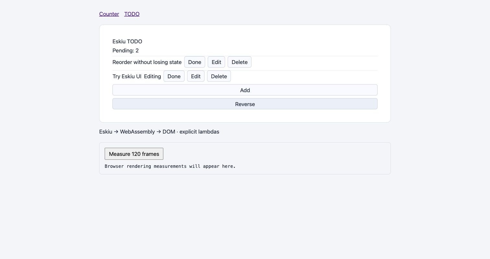
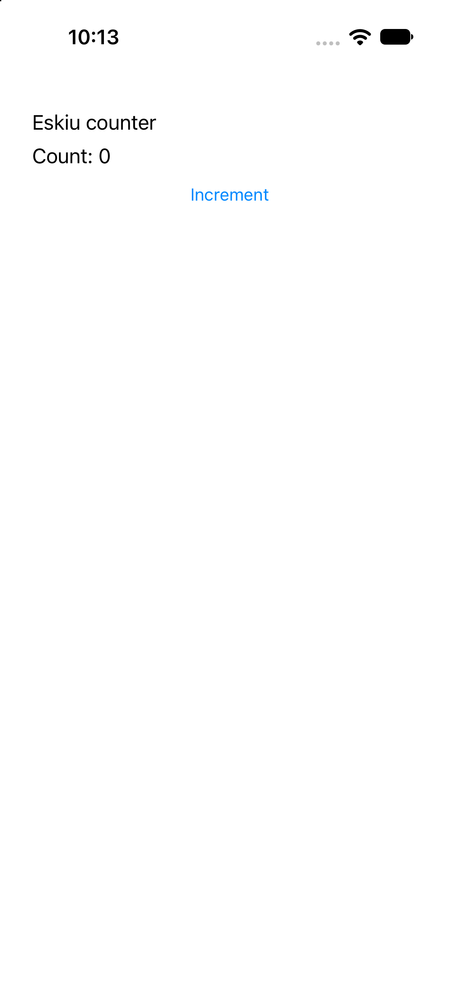
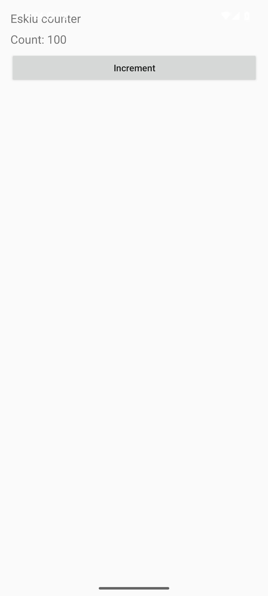
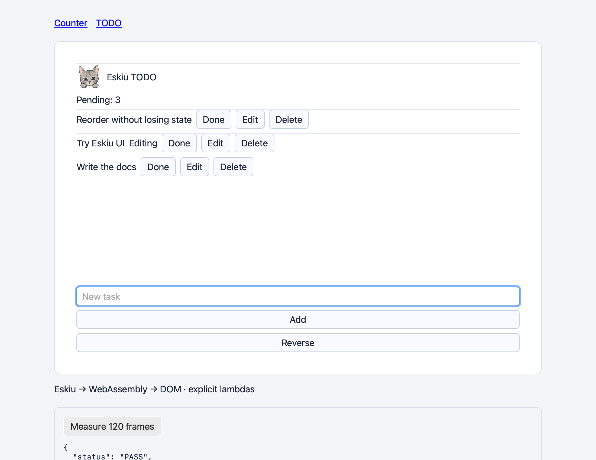

<p align="center">
  
</p>

<h2 align="center">ui</h2>
<p align="center">One UI in Eskiu for iOS, Android, the web and the desktop.</p>
<p align="center"><sub>Part of the <a href="https://github.com/eskiu-lang">Eskiu</a> project</sub></p>
<p align="center">
  <a href="https://eskiu-lang.org">eskiu-lang.org</a> &nbsp;&middot;&nbsp;
  <a href="#modules">Modules</a> &nbsp;&middot;&nbsp;
  <a href="examples/components.esk">Example</a> &nbsp;&middot;&nbsp;
  <a href="https://github.com/eskiu-lang/eskiu">The language</a>
</p>

<p align="center">
  <a href="https://github.com/eskiu-lang/ui/actions/workflows/ci.yml"></a>
  
  
  <a href="LICENSE"></a>
</p>

---

`ui` is a reactive UI framework in Eskiu. A component is an ordinary function, the view is
built by calls (`Column`, `Row`, `Text`, `Button`), and state lives in signals. The same
component code draws UIKit views on iOS and `android.view` views on Android, both laid out
by Yoga, and DOM elements on the web through WebAssembly; the desktop runs the web renderer
in a webview.

It follows the UI plan (`docs/dev/ui-plan.md` in the
[compiler repository](https://github.com/eskiu-lang/eskiu)). Phase 0 settled the runtime
model (scheduler, ownership, identity, renderer protocol) against executable tests; phase 1,
in progress, makes the core linear in the size of what changed. Views use explicit lambdas,
the form the planned trailing blocks will produce; the compiler is unchanged.

- **Fine-grained updates.** Each element's block records the signals it reads; when one
  changes, only that block runs again and its children are diffed.
- **Keyed identity.** `key(id)` keeps a row's node and state across reorders. Key zero is a
  key; an omitted key is not.
- **Commits.** A frame's mutations reach the renderer as one commit. Old handlers, nodes and
  strings are freed only after the renderer completes it, synchronously or later, and events
  that arrive meanwhile are queued.
- **Linear updates.** Children are matched through key tables, a reorder moves only the
  children outside the longest run that kept its order, and subscriptions are removed in
  O(1): 10,000 rows mount, reverse or unmount in under 10 ms.
- **One buffer per frame.** A commit is a single byte buffer the renderer decodes; the web
  renderer reads it from wasm memory in one call.
- **Checked rules.** Hooks are checked by count, kind and concrete type. Render loops,
  duplicate keys and memo cycles stop the program with a message that says where:
  `in Column[0] > TodoRow[key 3]`.

```eskiu
import <string>;
import <ui>;

void Counter() {
    Column(Style{padding: 16}, void() {
        *Signal<int> count = use_signal<int>(0);
        Text("Eskiu counter");
        String label;
        defer String_free(&label);
        String_format(&label, "Count: %d", count.get());
        Text(label.data);
        Button("Increment", void() { count.set(count.get() + 1); });
    });
}
```

With trailing blocks, planned for Eskiu 0.13, the same view reads:

```eskiu
void Counter() {
    Column(Style{padding: 16}) {
        *Signal<int> count = use_signal<int>(0);
        Text("Eskiu counter");
        String label;
        defer String_free(&label);
        String_format(&label, "Count: %d", count.get());
        Text(label.data);
        Button("Increment", void() { count.set(count.get() + 1); });
    }
}
```

`examples/components.esk` has the counter and a TODO list with keyed rows, per-row state and
a model-owned signal. `examples/app.esk` is the entry point the web, iOS and Android hosts
share.

## Modules

### `<ui>`

| Name | What it does |
|---|---|
| `Column(Style, fn()->void)`, `Row(...)` | A container; its block emits the children. |
| `Scroll(Style, fn()->void)` | A column whose content scrolls when it is taller than its space. |
| `Scope(string name, Key, fn()->void)` | A component's own scope (state and identity); `name` appears in diagnostics. |
| `Text(string)` | A text node. The text is copied. Format it with `<string>`'s `String_format`, which `-Wformat` checks. |
| `Button(string, fn()->void)` | A button and its handler. `Button_owned` adds a cleanup, run when the handler is replaced or unmounted. |
| `TextWith(Style, string)`, `ButtonWith(Style, string, fn()->void)` | Text and a button with a style (color, font, background...). |
| `Pressable(Style, fn()->void on_press, fn()->void block)` | A container that takes a press anywhere in it. |
| `Switch(Style, bool, fn(bool)->void)` | A controlled on/off switch. |
| `ActivityIndicator(Style, bool animating)` | The platform's busy indicator. |
| `TextInput(Input, fn(string)->void)` | A controlled text field: `Input{value, placeholder, label, focused}`; the handler gets each edit (borrowed for the call). `TextInput_focus` adds a focus handler. |
| `Image(Style, string source)` | An image from an http(s) URL or a bundled file; give it a width and height. |
| `Style{key, gap, padding, label, width, height, grow, wrap}`, `key(int64)` | Layout props and the accessible name (`label`: ARIA label, `accessibilityLabel`, `contentDescription`, an image's alt text); `key` sets identity among siblings. |
| `Style{background, color, font_size, font_weight, border_width, border_color, radius, opacity, align, justify}` | The visual props (StyleSheet's role): colors from `rgb(r, g, b)` / `rgba(...)`, `align` / `justify` from the `Align` / `Justify` members; a prop left at its default is not sent. |
| `ui_insets()`, `ui_is_active()`, `ui_window()` | The system bars, cutouts and keyboard (`Insets`, in points), whether the app is in the foreground, and the window size and scale; reading them subscribes. |
| `use_signal<T>(T)` | State owned by the current scope, by call order. |
| `signal_new<T>(T)`, `Signal_free` | State owned by the app's model: it outlives mounts and works with no runtime. |
| `Signal_get`, `Signal_set` | Read (and subscribe), write. A write during render applies after the render phase. |
| `use_memo<T>(fn()->T)` | A derived value, computed lazily; readers wake only when its value changes. |
| `use_effect(fn()->void)`, `on_cleanup(fn()->void)` | Work after each commit of its scope, parents first; the cleanup runs before the next run and at unmount. |
| `ui_init`, `ui_mount`, `ui_frame`, `ui_complete`, `ui_needs_frame`, `ui_shutdown` | The host's side: create, render a frame, report a commit complete. |
| `ui_event`, `ui_event_text`, `ui_event_focus`, `ui_event_toggle`, `ui_set_insets`, `ui_set_active`, `ui_set_window` | Events and environment from the host; an event during a commit is queued, its text copied. A refused edit or toggle is sent back, so inputs and switches are truly controlled. |
| `ui_decode(*uint8, int, List<Mutation>*)` | A commit as records, for tests and tools. Native hosts use `hosts/ui_commit.h`. |
| `ui.lenient` | Release behavior: a duplicate key warns and the later child is unkeyed instead of stopping. |

Node ids are reused once the commit that removed them completes, each time with a new
generation, so an event for a removed node never reaches the node that took its id.

Values in `use_signal<T>` need built-in equality (scalars and pointers); pointers stored in
it are borrowed. A throw out of a block, handler or effect is not caught: the program stops
through Eskiu's uncaught-exception reporter. A caller that catches it anyway finds the next
`ui_frame` or `ui_event` stopping with "runtime left mid-phase".

### `<ui/owned_string>`

`use_string(string)` holds an immutable, reference-counted `UiString`. `get()` borrows until
the next `set()`; `snapshot()` retains the value for a handler that outlives the render, and
the handler's cleanup releases it.

## Platforms

| Platform | Renderer | Checked |
|---|---|---|
| Web | `web/renderer.mjs` over the DOM, wasm through emscripten | Node with a recording DOM, Chromium, WKWebView |
| iOS | UIKit + Yoga, Objective-C++ host (`ios/host.mm`) | iPhone simulator, iOS 27 |
| Android | `android.view` + Yoga, Java activity and JNI shim (`android/`) | arm64 emulator, API 35 |
| macOS | the web renderer in WKWebView (`desktop/host.m`) | macOS 27 |
| Windows, Linux | not yet | |
| Physical phones | not yet | |

The native hosts are thin platform shims with a C API toward the Eskiu core; components and
state are Eskiu. Yoga 3.2.1 is downloaded for the iOS build, not vendored. By default the
root sits inside the safe area and above the keyboard; an app that returns 1 from
`ui_edge_to_edge` gets the whole screen and pads itself from `ui_insets()`. The web gives a
CSS flexbox with Yoga's defaults (border-box sizes, no shrinking, zero minimum size).

**Conformance.** `examples/conformance.esk` is one scene every renderer draws; each reports
the frame and accessibility role of every labeled element and the handler log after a fixed
script (two taps, typing "abc", a press and a toggle), plus the colors, radius, border,
opacity and font a styled box and a title were drawn with. `tools/conformance.py` compares them with the frames the
scene must have (within one point) on iOS, Android and the web; all three pass.

## Measurements

Arm64 Mac (Mac16,8), Eskiu 0.12.0, LLVM 22.1.8:

| Experiment | Result |
|---|---|
| 10,000 TODO mounts and unmounts, native `-O2` | about 40 ms |
| 10,000 renders replacing every handler, native `-O2` | about 12 ms |
| Recording renderer, 10 / 100 / 1,000 rows | p95 0.010 / 0.058 / 0.61 ms per frame |
| wasm module (counter and TODO) | 62,208 bytes; the build fails above 128 KiB |
| Chromium, counter / TODO, 120 frames | render and forced layout p95 1.1 / 8.3 ms |
| iPhone simulator, 100 taps | batched into one frame of 0.13 ms |
| Android emulator, 100 taps | batched into one frame of 1.4 ms |

Whole-list operations on 10,000 rows (`tests/benchmark.esk`, `-O2`), before and after
phase 1's indexing (the shared-signal row was measured once the other fixes were in):

| Operation | Before | Now |
|---|---|---|
| Mount | 124 ms | 8.1 ms |
| Reverse (every row moves) | 256 ms | 5.9 ms |
| One event and its frame | 230 ms | 5.4 ms |
| Unmount | 4,133 ms | 6.8 ms |
| A signal read by every row changes | 92 ms | 1.2 ms |

These are first baselines, not presentation-time or physical-device numbers;
`build/*-results.json` holds the latest machine-readable results.



| iOS | Android | macOS |
|---|---|---|
|  |  |  |

## Contributing

The tools find the compiler through `ESKIUC` (`ESKIUC_SELF` for the self-hosted one), an
`eskiu` checkout next to this repository (`ESKIU_ROOT` to point elsewhere), or the `PATH`.

```bash
tools/ci.sh                        # model, rejection and type-tag tests on a released eskiuc
python3 tools/check.py             # + allocation counting, ASan, -O0/-O2 and the self-host
python3 tools/build_web.py         # wasm and DOM renderer into build/web (emscripten)
node tests/web.mjs                 # the wasm module against a recording DOM
python3 -m http.server 8765 --directory build/web   # ?example=counter or ?example=todo

git clone --depth 1 --branch v3.2.1 https://github.com/react/yoga.git build/yoga
python3 tools/check_ios.py         # a booted simulator (DEVICE to pick one)
python3 tools/check_android.py     # SDK 35, NDK 28.2, a booted arm64 device (ANDROID_SERIAL)
python3 tools/check_desktop.py     # a WKWebView window running the web build (an awake display)
python3 tools/conformance.py       # the conformance scene on every available host
```

`tools/check.py` counts every allocation, closure environments included, by pointing the
test IR's allocator calls at `tests/heap.c`; each case and 10,000 mount and unmount cycles
must end at zero. The same tests run under AddressSanitizer, with a negative control that
must be reported. `tools/ci.sh` checks the behavior without the counting, which needs a clang
that reads the compiler's IR.

## License

MIT. See [LICENSE](LICENSE).
